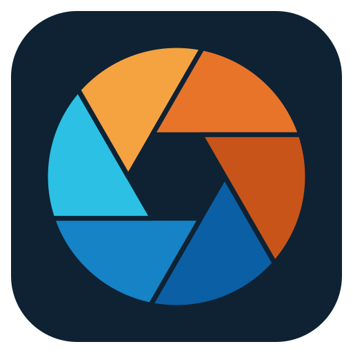
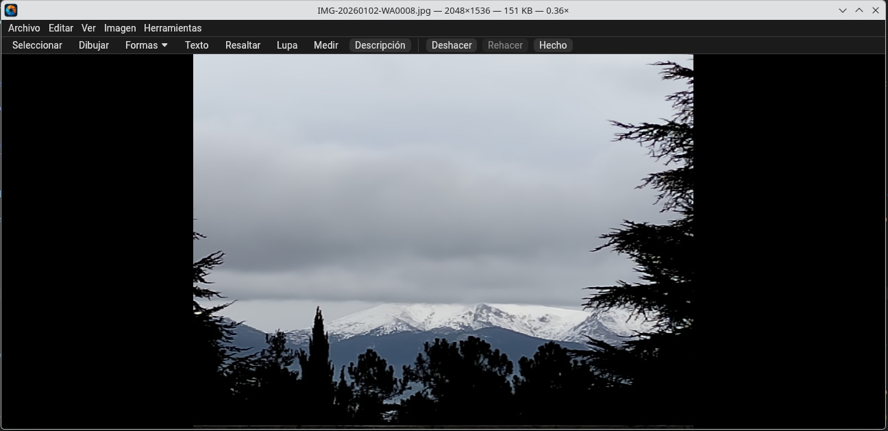
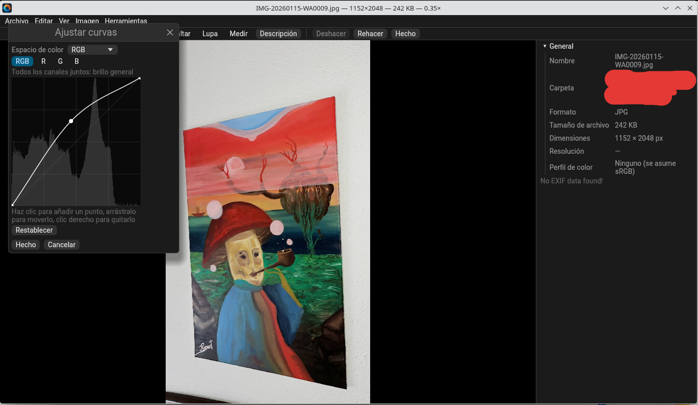
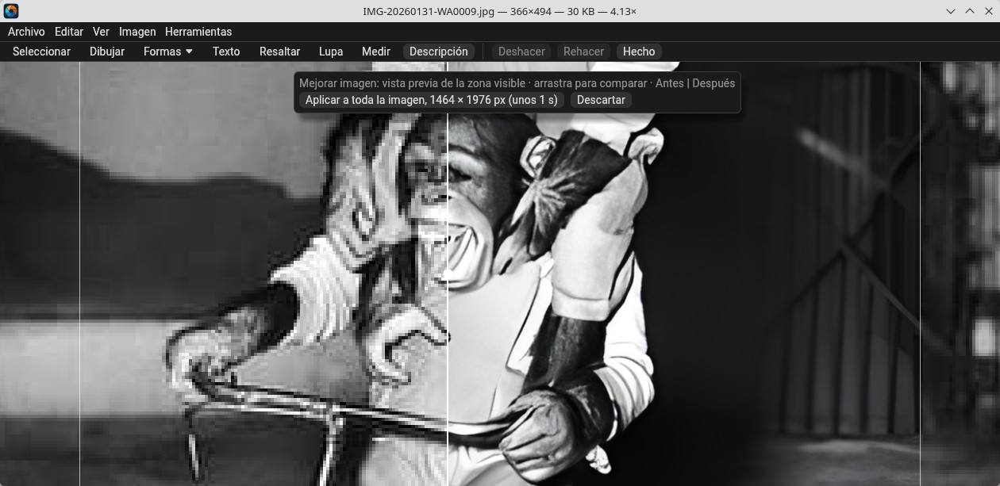

<p align="center">
  
</p>

<p align="center">
  <strong>Opening a photo shouldn't feel like a loading screen.<br>
  Circling something on it shouldn't take a second app.</strong>
</p>

# lightview

A fast, not-so-minimal image viewer for Linux, with experimental Windows builds, written in Rust.
It opens quickly, moves through a folder without waiting, and keeps your originals safe: edits are
only ever written to a file when you choose to save. It collects nothing: no telemetry, no account,
and it never goes online on its own.



## Main features

- **Opens instantly, browses without waiting.** A preview is on screen while the full image is
  still decoding, and the neighbouring images are decoded ahead, so the next one is already there.
- **Your originals stay safe.** Edits are only written to a copy, and only when you save one, with
  full undo and redo. Deleting moves the image to the Trash, and Ctrl+Z brings it back.
- **Mark up without a second app.** Arrows, shapes, freehand, text, highlights and a magnifier,
  right on the image.
- **Tidy up duplicates and bursts.** Group Duplicates in Folder finds copies, look-alikes and burst
  shots and moves each group into its own folder. You pick how alike the images must be and how big
  a group has to be, and see the groups before anything moves. Nothing is deleted, and Ctrl+Z puts
  everything back.
- **Local AI tools.** Remove a background or an object, denoise, upscale, brighten night photos
  and copy text out of an image, all on your own computer and offline. Nothing is installed until
  you ask for it ([AI tools](#ai-tools)).
- **Private by design.** No telemetry, no account, and it never goes online on its own.
- **Multilingual.** It starts in your system's language, and currently supports twenty-five, including Chinese, Japanese and Korean.
- **Accessibility features.** Menus, dialogs and settings can be read by a screen reader such as
  Orca or Narrator. All actions can be assigned their own keyboard shortcut. Adjustable UI font size,
  and a customizable high contrast theme.

Every feature, and the supported formats, are described in [`FEATURES.md`](docs/FEATURES.md).

## Screenshots

Adjust Curves, with the inspector sidebar open:



Enhance Image previews the visible area first. Drag the divider to compare before and after:



## Installation

lightview runs on Linux, on both Wayland and X11. It has been developed and tested on Kubuntu with
KDE Plasma. Windows builds are experimental.

### Ubuntu, Kubuntu, Mint, Pop!_OS, Debian 12 or newer (64-bit Intel/AMD)

1. Download the `.deb` file from the [Releases](../../releases) page.
2. Double-click it and choose Install.
3. Open lightview from your applications menu. The first time, it asks whether to become your
   default image viewer. You can change your mind later in Edit → Settings.

To uninstall, remove lightview in your software centre, or run `sudo apt remove lightview`.

### Windows (experimental, 64-bit)

Download the `.msi` file from the [Releases](../../releases) page and run it.

### From source (any other distribution)

You need a [Rust toolchain](https://rustup.rs) that supports the 2024 edition. From a checkout of
this repository:

```sh
./install.sh
```

This builds a release binary, installs it to `~/.local/bin`, adds a desktop entry, and **makes
lightview your default viewer** for JPEG, PNG, GIF, WebP, BMP and TIFF. To undo it, remove
`~/.local/bin/lightview`, `~/.local/share/applications/lightview.desktop` and
`~/.local/share/icons/hicolor/scalable/apps/lightview.svg`, then choose another default app in your
system settings.

To build without installing:

```sh
cargo build --release
```

### Optional system libraries

- **libjpeg-turbo** (`libturbojpeg.so.0`) makes JPEGs noticeably faster. It's loaded at run time, so
  no development package is needed, and lightview uses its pure-Rust decoder if it's missing.

On Linux, the AI downloads use the system's `curl`, `tar` and `unzip`.

## Usage

```sh
lightview                # open an empty window
lightview photo.jpg      # open an image
```

[`MENUS.md`](docs/MENUS.md) lists every menu item and shortcut.

Settings are saved in `~/.local/share/lightview/app.ron`.

## AI tools

Everything runs on your own computer, on the CPU or a GPU. Your images are never uploaded:
lightview only goes online to download the runtime and models you ask for, and after that the AI
tools work offline.

The AI tools are in the Local AI menu. They need ONNX Runtime, installed with Local AI → Download AI
Runtime…, and at least one model for the task. Models live in `~/.local/share/lightview/models`.

GPU support is optional, and Local AI → AI Models… offers two downloads:

- **NVIDIA** (CUDA, about 1.5 GB): the fastest choice, around 10× faster than the CPU on a GTX 1050.
- **AMD, Intel and others** (WebGPU, about 6 MB on Linux and 13 MB on Windows; experimental): any
  graphics card with Vulkan (Linux) or Direct3D 12 (Windows). On a GTX 1050 it denoised 2.5× faster
  than the CPU, but a weak built-in chip such as Intel UHD 630 was slower than the CPU, so try it
  and switch "Use the GPU" off if it doesn't help. On Linux it needs the system's Vulkan loader
  (`libvulkan1`). With both installed, NVIDIA's is used.

If the GPU can't be used, lightview falls back to the CPU and shows why.

There are two kinds of model.

### Models you download from the app

Local AI → AI Models… offers these models. Each download is pinned by SHA-256 and starts only after you
accept its licence.

| Task | Models |
|---|---|
| Remove, Blur or Replace Background | Silueta, U²-Net, IS-Net, BiRefNet |
| Denoise | SCUNet, SwinIR |
| Enhance Image | BSRGAN 4× |
| Remove Object | LaMa (best quality), MI-GAN (fast) |
| Select Object | MobileSAM |
| Recognize Text | PP-OCRv5 Latin (European languages), PP-OCRv5 (Chinese, Japanese and English) |

### Recognize Text and QR codes

Local AI → Recognize Text reads the selection, or the whole image if nothing is selected, and shows the
text in a window where you can copy all of it or just a part. A few things help it:

- **Level text.** It looks for horizontal lines, so straighten tilted text first (Image →
  Straighten…). Vertical text isn't read.
- **Select small text.** To stay fast, a large image is scanned for text at up to 1920 pixels on its
  long side. Small print in a big photo can be missed that way; select the area and it's read at
  full size.
- **Printed text.** Handwriting isn't supported.

Tools → Read QR Code needs no download. It shows what each QR code in the selection or image says;
links are only shown, never opened.

### Models you convert yourself

> [!IMPORTANT]
> Real-ESRGAN and DarkIR **can't be downloaded from lightview**, and no ONNX files of them are
> published. Every user has to create these files themselves and copy them into the models folder.

1. Follow the instructions in
   [lightview-models](https://github.com/pyubero/lightview-models) to convert the models you want.
   The files are written to its `dist/` folder.
2. Copy them into `~/.local/share/lightview/models`, or use Local AI → AI Models… → Add model file….
3. They then appear under Enhance Image in Local AI → AI Models….

Keep the file names below, because lightview recognises these models by name:

| File | Model |
|---|---|
| `RealESRGAN_x4plus_fp32.onnx` | Real-ESRGAN 4× |
| `RealESRGAN_x4plus_fp16.onnx` | Real-ESRGAN 4×, half precision |
| `realesr-general-x4v3_fp32.onnx` | Real-ESRGAN general 4×, faster and softer |
| `realesr-general-x4v3_fp16.onnx` | Real-ESRGAN general 4×, half precision |
| `DarkIR_384.onnx` | DarkIR, for dark and night photos, same size |

A renamed file is treated as an unknown model: it's listed under every tool, has to be picked by
hand, and doesn't get its tile size.

lightview doesn't verify these files or show their licences. The licences are in lightview-models,
in each model's folder. DarkIR's weights are CC-BY-4.0, which requires crediting the authors if you
share the converted file.

### Your own models

Any other `.onnx` file in the models folder is listed too. Local AI → AI Models… lets you adjust the
input size and normalisation of background removal models.

## Development

```sh
cargo test                 # run the tests
cargo run --release -- photo.jpg
lightview --timings photo.jpg   # print window, preview, full image and navigation times
lightview --bench photo.jpg     # the same, quitting after the first full image
```

| Document | Contents |
|---|---|
| [`FEATURES.md`](docs/FEATURES.md) | Every feature, and the supported formats |
| [`PROJECT_BRIEF.md`](docs/PROJECT_BRIEF.md) | Goals, scope, performance targets and early milestones |
| [`ROADMAP-v2.md`](docs/ROADMAP-v2.md) | Editing, markup, the AI tools and the Windows port |
| [`ROADMAP-v3.md`](docs/ROADMAP-v3.md) | Closing the gaps with other viewers: formats, colour, basics, reach |
| [`ROADMAP-v4.md`](docs/ROADMAP-v4.md) | More local AI, Group Duplicates in Folder, and the code rework |
| [`MENUS.md`](docs/MENUS.md) | Every menu item and shortcut |
| [`TRANSLATING.md`](docs/TRANSLATING.md) | How to correct a translation or add a language |

## Licence

lightview is free software: you can redistribute it and/or modify it under the terms of the
[GNU General Public License](LICENSE), version 3 or later. It comes with no warranty.

The fonts built into lightview are Apache-2.0 and MIT licensed; see [`fonts/NOTICE.txt`](fonts/NOTICE.txt).
Every package includes their licences and those of the Rust crates: in
`/usr/share/doc/lightview/copyright` from the `.deb`, and in `LICENSES.txt` in the Windows install
folder.

Third-party licences for the downloadable AI components are in [`licenses/`](licenses).
